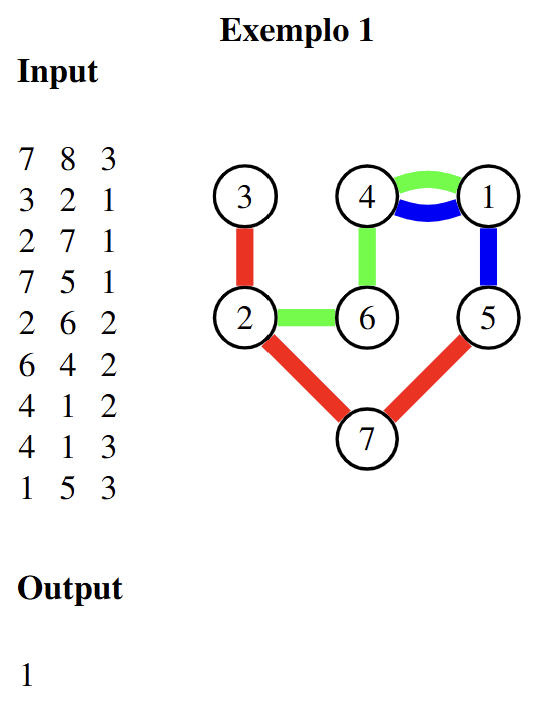

# 🚇 metro-network-connectivity

## 📋 Project Overview

The goal of this project is to calculate the connectivity of a metro network, defined as the maximum minimum number of line changes required to travel between any two stations.

The metro network is represented as an undirected multigraph, where:
- **Vertices** represent metro stations.
- **Edges** represent connections between stations on a specific metro line.

The connectivity of the network is defined as the maximum, over all pairs of stations, of the minimum number of line changes needed to travel between them.

The objective is to determine this value for a given metro network.

## 📥 Input Format

The input consists of:

1. Three integers `n`, `m`, and `l`, representing the number of stations, connections, and metro lines, respectively.
2. `m` lines, each containing three integers `x`, `y`, and `l`, indicating that stations `x` and `y` are directly connected by metro line `l`.

Multiple connections between the same pair of stations are possible, corresponding to different metro lines.

## 📤 Output Format

The program outputs a single integer representing the metro network connectivity:

- A positive integer representing the maximum minimum number of line changes required between any two stations.
- `0` if no line changes are necessary.
- `-1` if there are at least two stations that cannot reach each other.

## 📌 Example

The following image shows the first example provided in the project statement. The expected output is `1`, meaning that the maximum minimum number of line changes required between any two stations is one.

<p align="center">
  
</p>

## ⚙️ How to Run

### 🔹 1. Check Requirements

- **g++** — C++ compiler with C++11 support.
- **GNU Make** — build automation tool.

### 🔹 2. Compile

Using the Makefile:

```bash
make
```

### 🔹 3. Execute

Run the program using an input file:

```bash
./a.out < testfile
```

To test the examples provided in the `tests/` directory:

```bash
./a.out < tests/ex1.in
```

Compare the output with the corresponding expected result in `tests/res1`.

### 🔹 4. Generate Test Instances (Optional)

Compile the provided instance generator:

```bash
g++ gera.cpp -o gera
```

Run the generator using the following arguments:

```bash
./gera <V> <E> <L> <b> <seed>
```

**Arguments:**
- `V` — Number of stations (vertices).
- `E` — Number of connections (edges).
- `L` — Number of metro lines (colors).
- `b` — Whether all stations should be connected (`0` or `1`). Optional; requires `E >= V`.
- `seed` — Random seed for the generator. Optional.

For example:

```bash
./gera 7 8 3 1 42
```

This generates a network with 7 stations, 8 connections, and 3 metro lines, ensuring all stations are connected, using `42` as the random seed.

The generator source code is available [here](gera.cpp).

## 🤝 Authors

<p align="center">
  <a href="https://github.com/maddie0120">
    
  </a>
  &nbsp;&nbsp;&nbsp;
  <a href="https://github.com/xan-verse">
    
  </a>
</p>

## 📚 Project Description

You can find the full project description [here](p2.pdf).